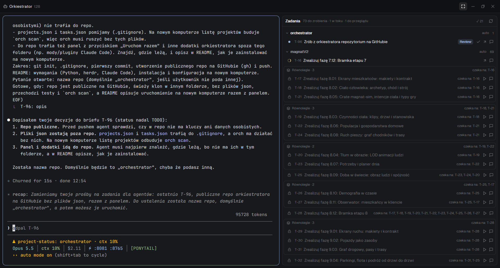

<div align="center">

# Orchestrator

**Jeden czat, wiele agentów.** Orkiestrator projektów dla [herdr](https://herdr.dev) i [Claude Code](https://claude.com/claude-code).




</div>

Rozmawiasz z jednym agentem Claude Code, orkiestratorem. On ustala, którego projektu dotyczy sprawa, i zamienia ją w zadanie z briefem i kryterium „gotowe, gdy”. Uruchamia je jako osobnego agenta w herdr. Agenci sami zgłaszają koniec pracy, a ty zatwierdzasz wynik w panelu zadań.

## Funkcje

- **Rejestr projektów.** `orch scan` znajduje repozytoria git w katalogu projektów, a orkiestrator dopasowuje sprawę do projektu po nazwie, opisie i słowach kluczowych.
- **Zadania w repozytorium projektu.** Każdy projekt ma `TASKS.md`, który można edytować ręcznie. `orch` synchronizuje go z centralnym `tasks.json` przy każdym odczycie.
- **Zależności i fale.** `--after T-6,T-7` układa zadania w fale (`F1`, `F2`, …). Zadania z jednej fali mogą iść równolegle, a `orch` odrzuca cykle i nieistniejące ID.
- **Równoległy start.** Kilka gotowych zadań uruchamia jednego agenta-koordynatora. Ten puszcza subagentów w osobnych worktree, scala ich pracę do głównej gałęzi i uruchamia build oraz testy.
- **Bezpieczne zamykanie.** Przy `done` `orch` sprawdza niezakomitowane zmiany i niescalone gałęzie. Gdy jest czysto, zamyka terminal agenta i usuwa scalony worktree.
- **Autopilot.** Opcjonalny, osobno dla każdego projektu: po `done` startuje kolejne zadania, których zależności są już spełnione.
- **Panel w herdr.** Tablica zadań z falami, startem jednym kliknięciem, przyciskiem „Uruchom razem” i zatwierdzaniem.

## Jak to działa

```
 Ty ──► Orkiestrator (Claude Code, CLAUDE.md)
              │  python orch.py add / start / edit
              ▼
          orch.py ──► <projekt>/TASKS.md + tasks.json
              │  herdr-app do tab.new / space.new
              ▼
          herdr ──► agent zadania (Claude Code albo Codex) w projekcie lub worktree
                         │
                         └─► orch.py edit T-n --status review
```

Orkiestrator nie edytuje kodu projektów. `.claude/settings.json` blokuje mu narzędzia Edit i Write, więc wszystkie zapisy idą przez `orch.py`.

## Wymagania

| Narzędzie | Do czego |
|---|---|
| Python 3.8+ | `orch.py`, tylko biblioteka standardowa |
| git | repozytoria projektów, worktree zadań |
| [herdr](https://herdr.dev) | `herdr-app` i `hc` (herdr-core) w `PATH` |
| [Claude Code](https://claude.com/claude-code) | orkiestrator i agenci zadań (`claude` w `PATH`) |
| Codex CLI (opcjonalnie) | zadania, w których trzeba generować obrazy |

Mody panelu i terminal orkiestratora są przygotowane pod Windows (PowerShell).

## Instalacja

```bash
git clone https://github.com/XangoAbada/orchestrator.git D:/Projects/orchestrator
cd D:/Projects/orchestrator
python test_orch.py      # wypisuje OK
python orch.py scan      # rejestruje repozytoria git z katalogu projektów
python orch.py projects
```

`projects.json`, `tasks.json` i `TASKS.md` orkiestratora to dane konkretnej maszyny i nie trafiają do repo. `orch` tworzy je przy pierwszym zapisie.

### Konfiguracja

| Zmienna | Domyślnie | Opis |
|---|---|---|
| `ORCH_ROOT` | `D:/Projects` | katalog z projektami; każdy podfolder z `.git` jest projektem |
| `ORCH_HERDR` | `["herdr-app"]` | polecenie herdr jako lista JSON |

Na stałe w PowerShell: `setx ORCH_ROOT "E:\code"`.

## Panel w herdr

Skopiuj zawartość `herdr/` do konfiguracji herdr: `%USERPROFILE%\.config\herdr-app\` (na macOS i Linux `~/.config/herdr-app/`). Herdr przeładowuje mody na żywo.

```bash
cp -r herdr/mods/* ~/.config/herdr-app/mods/
cp herdr/layouts/* ~/.config/herdr-app/layouts/
```

Potem przełącz layout na `main-limits` (`Ctrl+Shift+L` albo `layout.switch` z palety `Ctrl+Shift+P`). Przycisk **Orkiestrator** na pasku kart uruchamia terminal `orchestrator` i pokazuje go razem z panelem zadań. Przycisk obok przełącza widok pełnookienny ze zrzutu powyżej.

| Plik | Co to jest |
|---|---|
| `mods/tasks` | panel „Zadania”: fale, start, „Uruchom razem”, zatwierdzanie `done`; wszystkie zmiany idą przez `orch.py` |
| `mods/tabs-orch` | pasek kart z przyciskiem orkiestratora i widokiem pełnookiennym |
| `layouts/main-limits.json` | główny layout z `tabs-orch` i paskiem limitów |
| `layouts/orch.json` | widok pełnookienny: czat orkiestratora obok zadań |
| `mods/limits` | pasek zużycia limitów Claude i Codex; czyta lokalne tokeny z `~/.claude/.credentials.json` i `~/.codex/auth.json` |
| `mods/agents-ctx` | lista agentów z zajętością kontekstu (klon wbudowanego `agents`) |

`limits` i `agents-ctx` nie są potrzebne do samego orkiestratora, ale używa ich `main-limits.json`.

> [!NOTE]
> Jeśli orkiestrator leży gdzie indziej niż `D:\Projects\orchestrator`, popraw stałą `DIR` w `mods/tasks/main.js` i `ORCH_DIR` w `mods/tabs-orch/main.js`.

## Użycie

Zwykle rozmawiasz z orkiestratorem, a on sam wywołuje `orch`. Te same polecenia działają ręcznie:

```bash
python orch.py add moneeko "Dodaj eksport CSV" --brief - <<'EOF'
Cel: ...
Gotowe, gdy: ...
EOF
python orch.py list --project moneeko       # zadania w falach
python orch.py start T-12                   # agent w głównym checkoucie
python orch.py start T-12 --worktree        # agent w osobnym worktree
python orch.py start --ready moneeko        # wszystkie gotowe zadania przez koordynatora
python orch.py edit T-12 --status done      # zamyka zadanie, terminal i worktree
```

| Polecenie | Opis |
|---|---|
| `projects`, `project`, `scan` | lista projektów, edycja wpisu (opis, słowa kluczowe, autopilot), rejestracja nowych repozytoriów |
| `new`, `idea` | nowy projekt (folder, `git init`, `IDEA.md`) i notatki z brainstormingu |
| `add`, `edit`, `rm` | zadania: brief, zależności, status, agent |
| `list`, `show` | lista w falach, szczegóły zadania |
| `start` | uruchomienie w herdr: jedno zadanie, kilka naraz albo wszystkie gotowe |

Pełna pomoc: `python orch.py -h` oraz `python orch.py <polecenie> -h`. Zasady pracy orkiestratora opisuje [`CLAUDE.md`](CLAUDE.md).

## Testy

```bash
python test_orch.py
```

Test działa na kopii `orch.py` w katalogu tymczasowym, z atrapą herdr, więc nie rusza prawdziwych projektów ani okna.

## Struktura repozytorium

```
orch.py               CLI projektów i zadań
test_orch.py          test end-to-end z atrapą herdr
CLAUDE.md             instrukcje agenta-orkiestratora
.claude/settings.json uprawnienia orkiestratora
herdr/                mody i layouty panelu
docs/                 zrzuty ekranu
```

Pliki w `herdr/` to kopia modów działających w `~/.config/herdr-app`. Po zmianie moda tam skopiuj go z powrotem do repo.
